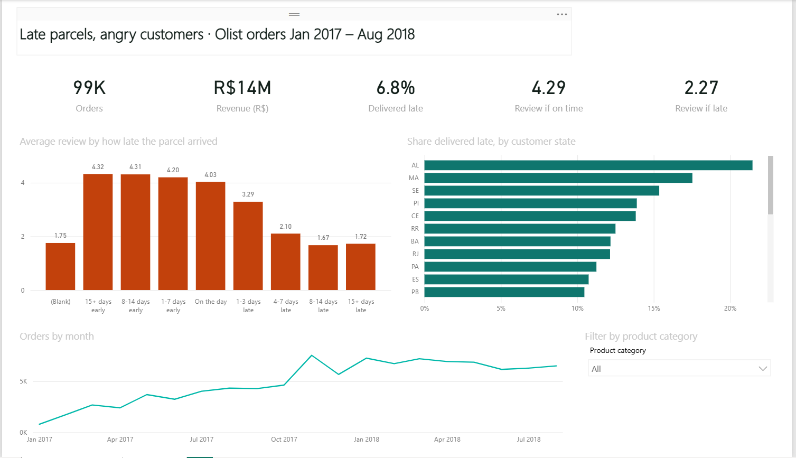
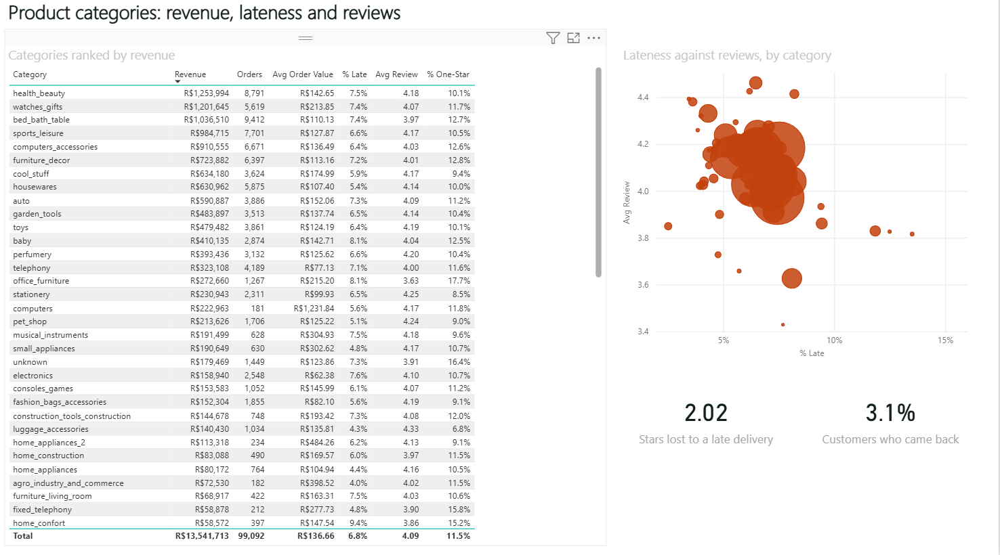

# Late parcels, in Power BI: the Olist warehouse as a semantic model

**A Power BI project on 100,000 real orders from Olist, a Brazilian online marketplace: a star-schema semantic model with 19 DAX measures and a two-page report on delivery and reviews. The whole project is written as code (a .pbip with TMDL and PBIR files), generated from one Python spec, and checked against Microsoft's JSON schemas on every push.**

Track: Data Analytics · Power BI, DAX, Power Query (M), TMDL, PBIR, Python, GitHub Actions · [Live page](https://qaisbello.github.io/data-analytics/olist-powerbi/) · Data from [olist-dbt-warehouse](https://github.com/QaisBello/olist-dbt-warehouse)





*The report in Power BI Desktop after a refresh. Every figure matches `docs/expected_values.md`, the pandas reference implementation of the DAX: R$13,541,713 revenue, 99,092 orders, 6.8% late, and 4.29 against 2.27 stars.*

## What the report shows (January 2017 to August 2018)

| Measure | Value |
|---|---:|
| Orders | 99,092 |
| Revenue (goods, excluding freight) | R$13.5m |
| Delivered late | 6.8% |
| Average review if on time / if late | 4.29 / 2.27 |
| Stars lost to a late delivery (Review Gap) | 2.02 |
| Customers who ordered again | 3.1% |

- **Page 1, Delivery and reviews:**
  - Five cards.
  - Average review by how late the parcel arrived.
  - Late rate by customer state.
  - Orders by month.
  - A product category slicer.
- **Page 2, Categories:**
  - Every category ranked by revenue, with orders, AOV, % late, average review and % one-star.
  - A scatter of lateness against reviews.
  - Two cards.

## Open it

1. Install **Power BI Desktop** (Windows, free). If your version is older than mid-2025, turn on *File > Options > Preview features > Power BI Project (.pbip) save option*, *Store semantic model using TMDL format* and *Store reports using enhanced metadata format (PBIR)*. Newer versions have these on by default.
2. Clone or download this repo and open **`Olist.pbip`**.
3. Click **Refresh**. The model downloads the CSVs from the warehouse repo on GitHub (about 55 MB). If asked, choose **Anonymous** access for `raw.githubusercontent.com`.
4. Check the cards against [`docs/expected_values.md`](docs/expected_values.md). In testing, every card, the category table and the lateness chart matched to the last digit.

To load the CSVs from your own copy of the data instead, change the **BaseUrl** parameter (*Transform data > Edit parameters*).

**If the report part will not open** (a newer or older Desktop can reject a report file), the semantic model still opens on its own: open `Olist.SemanticModel/definition.pbism` from a new report, then rebuild the visuals with the field lists in [`tools/generate.py`](tools/generate.py). Please open an issue with the error message.

## The semantic model

```
Calendar (1) ──► (*) Orders (*) ◄── (1) Customers
                       ▲ │
                (1) both ways (*)
                       │ ▼
Products (1) ──► (*) Order Items (*) ◄── (1) Sellers
```

- **Facts:**
  - **Orders**: one row per order, from `fct_orders`.
  - **Order Items**: one row per item sold, from `fct_order_items`.
- **Dimensions:**
  - **Calendar**: marked as the date table, from `dim_date`.
  - **Customers**: one row per person, not per order.
  - **Products**: with English category names.
  - **Sellers**.
- **Order Items to Orders filters both ways**, so the product category slicer reaches order-level measures. An order with items in two categories counts in both.
- **Power Query:**
  - Keeps the analysis window.
  - Adds a sorted **Lateness** band column (15+ days early to 15+ days late).
  - Adds a **Month** label sorted by date.
- **Implicit measures are switched off**, so every number in the report comes from a named measure.

## 19 DAX measures

| Folder | Measures |
|---|---|
| Sales | Order Count, Revenue, Freight, Avg Order Value, Customer Count, Revenue LY, Revenue YoY %, Revenue Running Total |
| Delivery | Delivered Orders, Late Orders, % Late, Avg Delivery Days |
| Reviews | Avg Review, Avg Review (Delivered), Avg Review (On Time), Avg Review (Late), Review Gap, % One-Star |
| Customers | Repeat Customer % |

The full DAX for each measure is in [`docs/measures.md`](docs/measures.md).

### One character that changes the answer

In DAX, `BLANK() = FALSE()` is **true**. Orders that never arrived (shipped, canceled or unavailable) have no lateness value. A filter written `Orders[is_late] = FALSE ()` therefore counts all 2,888 of them as on time. 2,769 of those orders have reviews, averaging 1.75 stars, which pulls "review if on time" down from **4.29 to 4.21**. The measures use the strict operator `==`, which treats blank as blank. With it, the result matches the dbt mart.

## A report written as code

```
Olist.pbip                        open this in Power BI Desktop
Olist.SemanticModel/definition/   TMDL: model, BaseUrl parameter, relationships, 6 tables with Power Query and measures
Olist.Report/definition/          PBIR: report, 2 pages, 15 visuals (one JSON file each)
tools/generate.py                 the spec: writes every file above, docs/measures.md and web/data/model.json
tools/validate.py                 schema and reference checks
tools/expected.py                 every measure recomputed in pandas -> docs/expected_values.md, web/data/report.json
tools/build_web.py                web/template.html -> web/index.html
```

`tools/validate.py` runs on every push (GitHub Actions) and checks:

- **Schemas:** every report file validates against Microsoft's published JSON schemas (from [microsoft/json-schemas](https://github.com/microsoft/json-schemas)).
- **Visual fields:** every column and measure a visual uses exists in the model, as the right kind.
- **DAX references:** every `[Measure]` and `'Table'[Column]` in the DAX exists, and no measure refers to itself.
- **Model structure:** relationships and sort-by columns point at real columns, and the date table has a key.

CI also regenerates the project and warns if the committed files differ from the spec. Saving in Power BI Desktop reformats some files, so if you change the model there, copy the change into `tools/generate.py`.

**Limits:** the checks run without Power BI. They do not run the DAX engine or render visuals. `tools/expected.py` covers the numbers: it applies the model's filter rules in pandas, and its results match the dbt marts.

```bash
pip install -r requirements.txt
python tools/generate.py     # after changing the spec
python tools/validate.py     # exit code 1 on any problem
python tools/expected.py     # reads the CSVs from GitHub (or pass a local folder)
```

## Data and licence

Brazilian E-Commerce Public Dataset by Olist, published under CC BY-NC-SA 4.0 and modelled in [olist-dbt-warehouse](https://github.com/QaisBello/olist-dbt-warehouse). Values are in Brazilian reais. This project is non-commercial.

---

Built by [Qais Adeniji-Bello](https://qaisbello.github.io) · [LinkedIn](https://www.linkedin.com/in/qais-adeniji-bello/)
